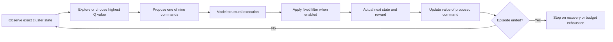
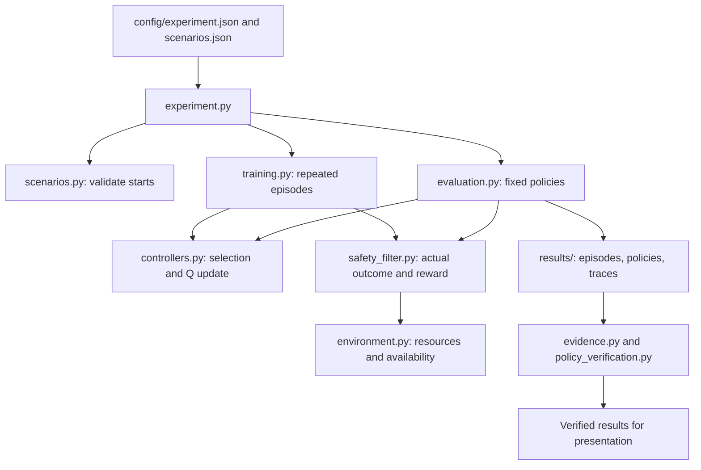

# Source-backed visuals for the project presentation

The proposed visuals explain the implementation, present measured evidence, and support the conclusions. Quantitative charts use original scientific artifacts or verified reproduction files. Diagrams explain the model and code; they are not performance evidence. No edited deck or recording is created by this plan.

## Recommended set

| Visual | Audience question | Answer | Actual source | Potential presentation placement |
|---|---|---|---|---|
| Three-node cluster diagram | What is recovering, and why do actions affect later choices? | Web, database, and batch services recover across three capacity-limited nodes. Commands change placement, demand, and availability; web also depends on the database, so one intervention changes subsequent recovery options. | environment.py State/DEMAND/available; submitted Part 1 | Slide 2 or 4 |
| Recovery learning loop | How does the agent learn rather than follow fixed rules? | Training explores commands and updates their Q values from actual rewards and discounted future values. Evaluation uses learned values without updates; the rule controller and filter retain fixed logic. | training.py; controllers.py update; safety_filter.py step | Slide 6 |
| Module workflow map | How do the code files work together? | The experiment coordinates scenarios, training, and evaluation. Controllers select commands; the simulator and filter produce outcomes; evidence modules verify policies, traces, and aggregated metrics. | src/edge_recovery modules and run_experiment.py | Slide 7 |
| Training/validation/test protocol | How are selection and final testing separated? | Twelve configurations supply training experience; four select alpha using five seeds per candidate and condition. Selection is saved before ten fresh final seeds per learner are evaluated on eight held-out configurations. | experiment.py; config/; frozen_protocol.json | Slide 8 |
| Learning return curve | Does exploratory training return change? | Mean exploratory return improves from early to late training, and the two conditions overlap. This describes training behavior; it does not establish convergence or held-out recovery. | results/original_run/final/*/*/curve.json or episodes.csv | Slide 9 |
| Recovery comparison and per-fault chart | Where does learning succeed or fail against the baseline? | Both learners recover all training starts but only the two held-out crash starts: 2/8 per seed (25%). They fail held-out CPU, memory, and node faults. The rule controller recovers 8/8 (100%). | evaluation.csv; seed_aggregates.json; per_fault.json | Slides 10–11 |
| Agent trace storyboard | What does a working policy actually do? | For seed 1000, filtered node_0 recovery uses three restore commands. On cpu_4, the learner repeats restart for 20 steps and fails; the rule controller migrates once and succeeds. | traces.jsonl; saved seed-1000 policies; simulator | Slide 12 before or alongside live demo |
| Unseen-state reasoning chain | Why does held-out performance fail? | Every held-out learner decision uses an unseen exact state. Zero Q values and fixed ties select restart, which cannot resolve persistent overload or node failure. Evaluation does not learn from these states. | policy tables; unseen counts; greedy tie code; cpu_4 traces | Slide 14 |
| Filter boundary comparison | How does a prohibited proposal differ from execution? | The filter replaces an executable prohibited proposal with wait while retaining its proposal penalty. The boundary fixture verifies blocking; final evaluations contain no prohibited proposals and show no filter advantage. | boundary_demo.py development fixture and step audit fields | Slide 12, separately labeled development test |
| Part 1-to-evidence matrix | Which planned objectives are supported or unresolved? | The inspectable model, specified constraint checks, and training recovery are supported. The 90% held-out target is unmet; filter superiority, convergence, and production safety are not established. | submitted Part 1; experiment_protocol.md; summary.json | Conclusion or appendix |

A focused 13–15-minute presentation can combine the learning loop, module workflow, per-fault results, and trace storyboard. Replacing dense text with these visuals limits additional slide count. Recording review is needed to establish actual duration after a revision.

## Learning loop: proposed diagram

The Q update belongs beside the learning loop. Terminal transitions still update Q with zero bootstrap before the episode ends. The evaluation diagram excludes exploration and the update arrow. The rule controller has a separate fixed ranking, and the safety filter has fixed checks; neither component learns. The physical model determines the affected service. The learner selects the command within that model.

## Code workflow: proposed diagram

Function names and concise responsibilities identify the implemented workflow. This is a conceptual dependency/workflow diagram, not a literal call graph of every helper.

## Quantitative evidence design

Recovery chart: grouped bars for filtered Q, unshielded Q, and rule, with training and held-out splits. Learner rates are summarized within each of ten seeds; held-out denominators are eight configurations per seed. Rule evaluation uses each configuration once. Show 2/8 versus 8/8, not only percentages. The hand-designed configurations are not a sampled population.

Per-fault chart: four grouped categories, crash/CPU/memory/node, with the same three controllers and a zero-to-100% axis. Each held-out fault contains two configurations per seed. This makes the crash-only learned recovery visible. Seed SD zero is descriptive, not a confidence interval.

Training curve: the current slide uses 1,000-episode bins formed from five equal 200-episode summaries per seed. Seed-level bins are averaged across ten final seeds. The label identifies exploratory return, and distinct line styles distinguish overlapping conditions. This curve does not establish convergence or held-out improvement.

Metric comparison: keep steps, return, and critical outage in separate panels or a concise table because their units differ. Critical outage means post-command service-decision intervals, not seconds. Include failures in all-episode step averages. A chart of zero executed violations must disclose that all controllers also have zero prohibited proposals in final evaluation.

## Actual trace examples

| Case | Verified commands | Steps | Return | Interpretation |
|---|---|---|---|---|
| Filtered node_0, seed 1000 | restore_N3, restore_N2, restore_N2 | 3 | −26 | Learned training recovery; rewards −16, −6, −4 |
| Filtered cpu_4, seed 1000 | restart repeated to exhaustion | 20 | −480 | Unseen-state tie selects a structurally ineffective command |
| Rule cpu_4 | migrate_N1 | 1 | −4 | Fixed rule ranking recovers this held-out start |

The storyboard can show the initial layout and each recorded resulting layout, availability, command, and reward. node_0 is training evidence, not proof of transfer. cpu_4 is one failure example, not the aggregate held-out return (−360.5). The development filter fixture is outside final evaluation.

## Reasoning and conclusion

The explanatory chain is: held-out exact state is absent from the Q-table → all nine values default to zero → fixed tie chooses restart → persistent overload remains → budget is exhausted. Every link is supported by policy lookup, controllers.py, and saved traces. This is the implemented explanation; state abstraction or a fallback remains proposed future work.

The Part 1 matrix can mark: inspectable model and specified constraint checks supported; training recovery supported; 90% held-out planning target not achieved; filter advantage not established; production integration not tested. Measured findings remain separate from proposed improvements.

## Integration limits

The current v4 is the editable presentation source. Its canonical source labels, native charts, workflow diagrams, and trace storyboard are mapped in docs/presentation_alignment.md. The earlier visual proposals remain design context; their presence here does not establish that every proposed visual was adopted. Additional diagram or chart changes require presentation verification. Code/figure improvements do not establish face/voice recording coverage, presentation duration, instructor access, or submission.
